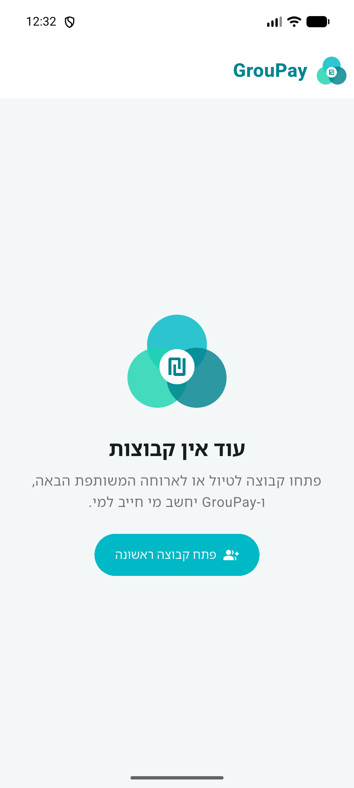
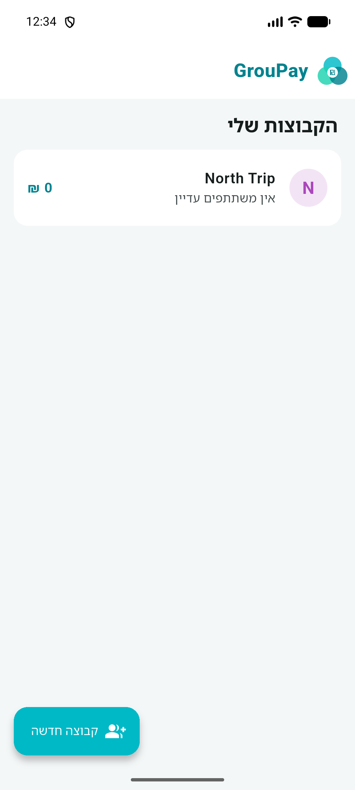
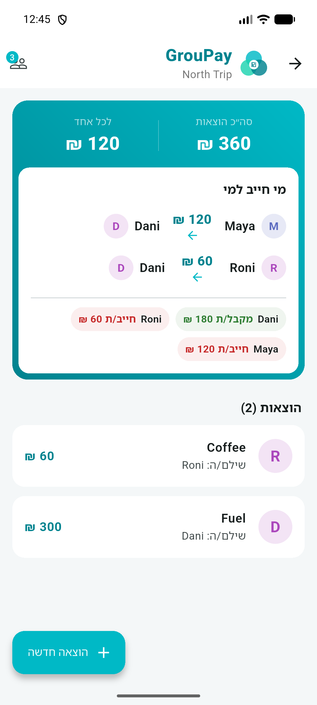
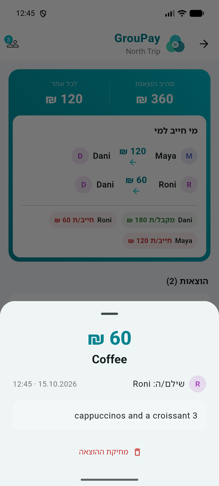

<p align="center">
  
</p>

<h1 align="center">GrouPay</h1>

<p align="center">Split shared trip and restaurant expenses within a group, inspired by the Israeli bit app</p>

---

## About

A group of friends goes on a trip or out to dinner, and each of them pays for some of the expenses. In the end, the total cost should be split equally among everyone.

GrouPay keeps a group for each trip and shows, in real time, how much each person's share is and who needs to pay whom.

This is a learning project built as part of an AI-assisted development course. The app UI is in Hebrew (right-to-left) with amounts in shekels (₪).

## Screenshots

| Home (empty) | Groups list | Who owes whom | Expense details |
|:---:|:---:|:---:|:---:|
|  |  |  |  |

## Features

- **Groups:** create a group for each trip; long-press a group to delete it.
- **Members:** add members to a group. Duplicate names are blocked, and a member who paid for an expense cannot be deleted.
- **Expenses:** add an expense with the payer, amount, a short title and free-text details. Tap an expense to see its details or delete it.
- **Who owes whom:** the top of the group screen shows the total, each person's share, the transfers needed to settle up, and every member's balance.

## How the split is calculated

1. All amounts are stored in agorot (integers) to avoid floating-point rounding errors.
2. The total is split equally among the members. Any leftover agorot are handed out one at a time, so the shares always add up exactly to the total.
3. Each member's balance is what they paid minus their share. Positive means they are owed money; negative means they owe money.
4. Transfers are computed greedily: at each step, the member who owes the most pays the member who is owed the most, until everyone is settled.

**Example:** Dani paid ₪300 and Roni paid ₪60. The total is ₪360, so each of the three members owes ₪120. Roni pays Dani ₪60, and Maya pays Dani ₪120.

## Tech stack

- **Flutter** (Dart): one codebase for Android, with iPhone support planned
- **Material 3**: Hebrew right-to-left UI in a turquoise theme
- **provider**: state management
- **Storage:** a local JSON file on the device (`groupay_data.json`)

## Running the app

Requirements: the [Flutter SDK](https://docs.flutter.dev/get-started/install) and an Android emulator or a connected device.

```bash
flutter pub get
flutter run
```

Tests:

```bash
flutter test
```

## Project structure

```
lib/
  main.dart                   app setup, Hebrew locale and RTL
  theme.dart                  colors and styling
  models/                     Group, Member, Expense
  data/json_storage.dart      saving and loading the JSON file
  state/app_state.dart        app state and all actions
  logic/                      split calculation and amount formatting
  screens/                    app screens
  widgets/                    logo, app bar, settlement card and more
test/                         unit and widget tests
tool/render_icon_test.dart    renders the launcher icon from the logo
```

## What's next

- Editing expenses and members
- User accounts, so each member can enter their own expenses
- Cloud storage and syncing between members
- An iPhone version
