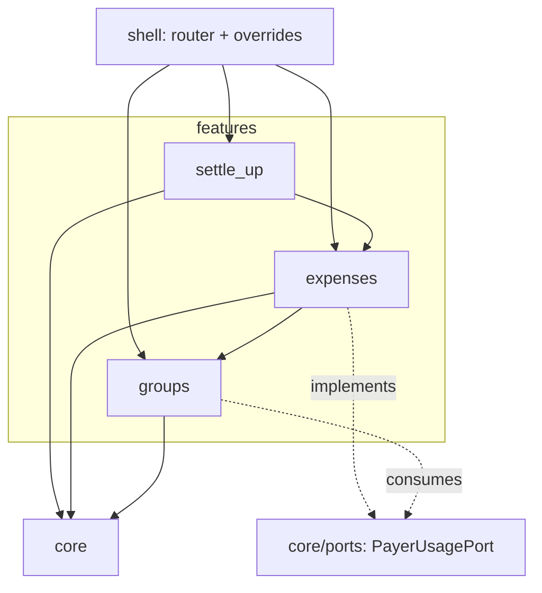
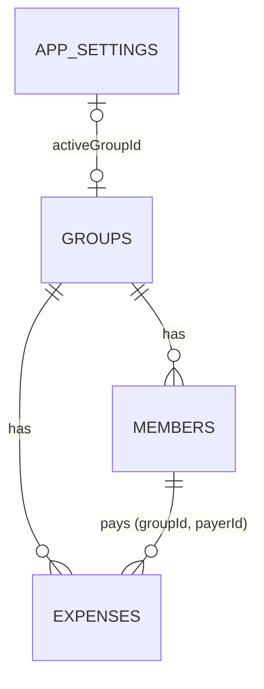
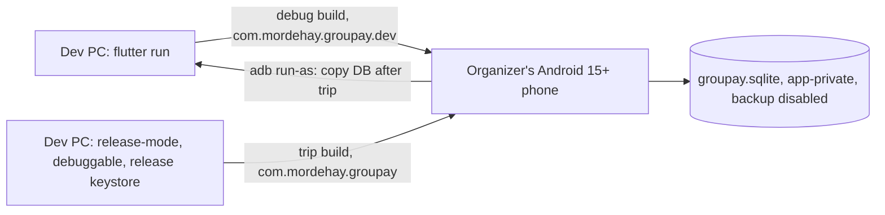

# Architecture Spine: GrouPay v1

## Design Paradigm

**Layered ports-and-adapters, organized feature-first, with one composition root.** Each feature folder is a vertical slice with four layers. Dependencies point inward to `domain/`. `domain/` is pure Dart: it never imports Flutter, drift, or Riverpod. `lib/shell/` sits above every feature. It is the only place that knows every concrete implementation.

| Layer | Holds | May import |
| --- | --- | --- |
| `shell/` | `main`, the router, `ProviderScope` overrides | everything |
| feature `ui/` | screens and feature widgets | own `app/` and `domain/`, `core/` (non-db), lower features' `domain/` and `app/` |
| feature `app/` | Riverpod providers and notifiers, plus repository provider declarations | own `domain/`, `core/` (non-db), lower features' `domain/` and `app/` |
| feature `domain/` | entities, repository interfaces, pure rules and calculations | `core/` (non-db, non-ui), lower features' `domain/` |
| feature `data/` | repository and port implementations | own `domain/`, `core/`, lower features' `domain/` interfaces |
| `core/` | shared kernel (see Structural Seed) | no feature, no `shell/` |

## Invariants & Rules



### AD-1: Flutter, platform-neutral core [ADOPTED]

- **Binds:** all
- **Prevents:** a later port to iOS, web, or desktop that needs a rewrite.
- **Rule:** The app is Flutter (Dart), built on the `bmad-rebuild` scaffold. v1 ships Android only (NFR-17). `core/`, `domain/`, `app/`, and `data/` use no Android-only plugin unless it sits behind an interface in `core/`.

### AD-2: Feature slices and dependency direction

- **Binds:** all features
- **Prevents:** an import cycle between `groups` and `expenses`, and features reaching into each other's internals.
- **Rule:** There are three features: `groups` (FR-1..9), `expenses` (FR-10..14, which includes the Group page), and `settle_up` (FR-15..16). Direct imports go downward only: `settle_up → expenses → groups`, following the layer table. A lower feature gets a fact owned by a higher one through a **port**: an interface in `core/ports/`, implemented in the higher feature's `data/`. Navigation between features uses route paths, never imports.

### AD-3: Table ownership means write rights

- **Binds:** NFR-13, all tables
- **Prevents:** two features writing one table under different rules.
- **Rule:** Each table has exactly one owning feature, and only that feature's repository writes to it. `groups` owns `groups`, `members`, and `app_settings`. `expenses` owns `expenses`. `settle_up` owns nothing and only reads. Other features read owned data only through the owner's repository interface or a port, never through a raw query.

### AD-4: Single data-access boundary

- **Binds:** NFR-13, all `ui/` and `app/` code
- **Prevents:** widgets or providers querying drift directly, which would bypass guards and block a future sync layer.
- **Rule:** Only `data/` and `core/db/` import drift. A repository interface lives in its feature's `domain/`. Its provider is declared in the same feature's `app/` and throws until `shell/` overrides it with the drift implementation. A future synced implementation replaces the drift one by changing only that override.

### AD-5: Riverpod is the only state and DI mechanism

- **Binds:** all `ui/`, `app/`, `shell/`
- **Prevents:** a mix of setState, Provider, and Bloc across screens, stale screens, and duplicate database instances.
- **Rule:** Every provider is declared with `riverpod_generator` (`@riverpod`). Reads are providers wrapping repository `.watch()` streams; no screen caches or refreshes data by hand. Writes are notifier methods that call a repository. The database, repository, and port providers are `keepAlive: true`. Port implementations depend only on `AppDatabase`, so the provider graph stays acyclic. Use `setState` only for ephemeral widget-local input.

### AD-6: Atomic, guarded writes

- **Binds:** NFR-9, every repository write
- **Prevents:** a partial save, and a guard checked against data that changes before the write.
- **Rule:** Each user action that writes runs as **one** `db.transaction`. Inside it, the repository first gathers its facts, using its own tables, constructor-injected lower-feature repository interfaces, and ports. It then calls the `core/policy` function, and only then writes. A guard never runs only in a notifier or widget. The app has exactly one `AppDatabase` instance, so every repository and port joins the same zone-scoped transaction.

### AD-7: Rules live in core/policy, and they are pure

- **Binds:** NFR-14, FR-2, FR-4, FR-6, FR-8, FR-10, FR-13, FR-14, FR-15, FR-16
- **Prevents:** rules duplicated per screen, guards that exist only in the UI, and multi-user rules that later need a rewrite rather than a replacement.
- **Rule:** `core/policy` contains pure functions. Each takes a fact record (defined beside the function) and returns a `Verdict`: allowed, or a `MessageKey`. The set is closed. A new guarded rule is added here, not in a feature.

  | Function | Guards |
  | --- | --- |
  | `isGroupMutable` | rename Group; add, rename, or remove Member; add, edit, or delete Expense (FR-6) |
  | `mayArchive`, `mayRestore`, `maySetActive` | Archive and Active-group transitions (FR-6, FR-8). These do not call `isGroupMutable`. |
  | `mayAddMember` | at most 10 Members (FR-2) |
  | `mayRemoveMember` | Member is not a Payer (FR-4) |
  | `mayModifyExpense` | edit and delete (including long-press) (NFR-14) |
  | `mayRecordExpense`, `maySummarize` | at least 2 Members (FR-10, FR-16) |
  | `defaultPayer` | FR-10 |
  | `nextSaveSeq`, `nextMemberSeq` | save-order source (FR-15, NFR-14) |

### AD-8: Identity and time

- **Binds:** NFR-11, NFR-12, all records, SM-C1
- **Prevents:** per-feature id schemes, and timestamps set by the UI or in local time.
- **Rule:** Every Group, Member, and Expense id is a UUID v7 string generated on the device (see AD-23 for when). `createdAt` and `modifiedAt` are UTC epoch milliseconds (`int`), set only by repositories from one clock provider. `createdAt` is set once on insert. `modifiedAt` is set on insert and on every edit. An Expense's recorded time is its `createdAt` (FR-10).

### AD-9: Sequence numbers, not clocks, decide order

- **Binds:** FR-10, FR-12, FR-15, member ordering
- **Prevents:** ordering or tie-breaking by clock or by row id.
- **Rule:** In each Group, `expenses.saveSeq` and `members.memberSeq` are `MAX + 1`. Each is assigned once, inside the insert transaction, through `core/policy`, and is never changed by an edit. The pairs `UNIQUE(groupId, saveSeq)` and `UNIQUE(groupId, memberSeq)` are enforced. A number freed by deleting the newest row may be reused. The Expense list order, the default Payer, and the Leftover tie-break use `saveSeq`. "Earliest-added Member", payer-picker order, and avatar color use `memberSeq`.

### AD-10: Hard delete

- **Binds:** FR-4, FR-14
- **Prevents:** some queries filtering tombstones and others not, which would let deleted Expenses leak into the Transfer list.
- **Rule:** Member removal and Expense deletion are SQL `DELETE`. v1 has no `deletedAt` column. Groups are never deleted, only archived (FR-6).

### AD-11: Split is computed, never stored

- **Binds:** FR-2, FR-4, FR-15, FR-16, NFR-5, NFR-16
- **Prevents:** a stored participant list that drifts from "split among all current Members", and a calculation scattered across SQL and widgets.
- **Rule:** An Expense stores no participants. The Transfer list comes from one pure function in `settle_up/domain`. Its input is one consistent snapshot of the Group's Members and Expenses, read in a single read transaction. It runs only when `maySummarize` allows. It is an exact search over zero-sum partitions (addendum), never greedy matching. SQL only fetches rows. No widget or query computes a Share, a Balance, or a Transfer.

### AD-12: Money is integer tenths

- **Binds:** NFR-7, NFR-15, FR-11, FR-15
- **Prevents:** floating-point error, and amounts parsed or displayed in divergent ways.
- **Rule:** Every amount is a `Tenths` value (an `extension type` over `int`, in `core/money`) stored in an integer column. `double` never holds money. Keypad input is parsed and bounds-checked (FR-11) only in `core/money`. Amounts are displayed only through `formatShekel()`: `₪`, thousands grouping, no decimal when the amount is whole and otherwise exactly one, isolated as an LTR run.

### AD-13: Name text rules in one place

- **Binds:** FR-1, FR-2, FR-3, FR-5, FR-15, FR-16
- **Prevents:** uniqueness checks, length limits, or alphabetical order that differ between features or between Dart and SQL.
- **Rule:** `core/text` alone defines these rules:
  - Normalization trims the name.
  - The uniqueness key (`nameKey`) is the case-folded name.
  - Length is counted in grapheme clusters (`characters`).
  - FR-15 collation:
    - Hebrew, in alphabet order, then Latin A–Z ignoring case, then digits, then geresh, then any other character by Unicode value.
    - Final letters fold to their regular form.
    - A prefix sorts before the longer name.
    - Unicode value breaks any remaining tie.

  `groups.nameKey` is `UNIQUE` across all Groups, including archived ones. `UNIQUE(members.groupId, nameKey)` applies to Members. A rename excludes its own row from the check. SQL `lower()` and `NOCASE` are never used on names.

### AD-14: Hebrew strings and bidi

- **Binds:** NFR-6, FR-16, all `ui/`
- **Prevents:** hard-coded strings, inconsistent wording, and user-entered names that reorder RTL sentences.
- **Rule:** The locale is fixed to `he` with RTL layout. Every user-visible string comes from the `MessageKey` table in `core/i18n`; widgets hold no Hebrew literals. Every user-entered name (Member or Group) enters a sentence only through `isolateName()`. It wraps the name in FSI/PDI and adds a hyphen after a Hebrew prefix when the name does not start with a Hebrew letter. Direction is never shown with an arrow or symbol.

### AD-15: Error shape

- **Binds:** all repositories and notifiers
- **Prevents:** some screens catching exceptions while others check return values.
- **Rule:** Repository writes return `Result<T>` from `core/result`. A validation or policy violation is `Failure(MessageKey)`. An exception means a bug or an I/O fault, never an expected rejection.

### AD-16: Navigation

- **Binds:** FR-6, FR-7, FR-9, FR-10, all screens
- **Prevents:** inconsistent back behavior, and a broken stack when the app launches into a Group or a Group is created or restored.
- **Rule:**
  - Only `go_router` in `shell/` navigates.
  - Route tree: `/` (group list) contains `create`, `group/:id` (with `add`, `edit/:eid`, `settings`, `summary`), and `archive` (with `group/:id` and its `summary`).
  - Launch:
    - `shell/` reads `activeGroupId` before `runApp`.
    - It passes the matching route as `initialLocation`, so the group list never flashes first.
  - After a Group is created or restored, the app navigates with `go('/group/:id')`.
  - Read-only mode comes from `isGroupMutable`, never from the route.
  - A redirect blocks `add`, `edit`, and `settings` for an archived Group.
  - Unsaved input is guarded by `PopScope` and the shared exit sheet.
  - Every route uses `NoTransitionPage`.

### AD-17: Active group storage

- **Binds:** FR-6, FR-7, FR-8, FR-9
- **Prevents:** a second store (such as shared_preferences), and an Active group that points at a missing or archived Group.
- **Rule:** The Active group is `app_settings.activeGroupId`, a nullable FK in a single-row table owned by `groups`. Archiving a Group clears it in the same transaction.

### AD-18: Schema, integrity, and migrations

- **Binds:** NFR-9, `core/db`
- **Prevents:** orphan Expenses, a Payer from another Group, a lost commit on power loss, and an app update that drops data.
- **Rule:**
  - `beforeOpen` sets `PRAGMA foreign_keys = ON` and `synchronous = FULL`.
  - `expenses(groupId, payerId)` references `members(groupId, id)` with `ON DELETE RESTRICT`. This backs up the FR-4 policy.
  - Category is a Dart enum stored as a stable string key, never as localized text. A key is never renamed.
  - `schemaVersion` starts at 1.
  - Every schema change does three things:
    - bumps `schemaVersion`;
    - adds a migration step generated by `dart run drift_dev make-migrations`, with the database listed in `build.yaml`;
    - commits the schema snapshot and the generated migration test.

### AD-19: Distribution, signing, and on-device privacy

- **Binds:** NFR-9, NFR-10, NFR-17, Android build
- **Prevents:** a signature mismatch that forces an uninstall and wipes the trip data, and data leaving the device through backup.
- **Rule:**
  - `applicationId` is `com.mordehay.groupay` and never changes.
  - `minSdk` is 35.
  - Debug builds use `applicationIdSuffix ".dev"`.
  - Every build installed as `com.mordehay.groupay` is signed with the dedicated release keystore, which is kept outside git and backed up.
  - Backup is disabled:
    - `android:allowBackup="false"`;
    - `dataExtractionRules` exclude every domain.
  - The trip phone runs a release-mode build with `isDebuggable = true`, signed with the release keystore under `com.mordehay.groupay`. This keeps release performance (NFR-5) and lets `adb run-as` copy the database for SM-C1 and SM-C2 (PRD §9).

### AD-20: Tables are defined in core/db

- **Binds:** all tables, `core/db`, feature `data/`
- **Prevents:** `core/db` importing features, a `data/` ↔ `core/db` generated-code cycle, and FKs that would need one feature's `data/` to import another's.
- **Rule:** Every drift table, index, and FK is defined in `core/db/tables/`, and `AppDatabase` registers them all. Generated row classes are named `*Row`, and only `data/` uses them. Every repository maps rows to its feature's `domain/` entities before returning. Ownership (AD-3) controls who writes, not where a table is declared.

### AD-21: shell is the composition root

- **Binds:** `lib/shell/`, all providers and routes
- **Prevents:** two features each building the router or binding the same interface differently.
- **Rule:** `shell/` alone owns three things:
  - `main()`;
  - the `go_router` configuration;
  - the `ProviderScope` overrides that bind every repository and port interface to its drift implementation.

  The text scale is clamped to 1.5 there. Features export screens and providers. They never construct another feature's implementation.

### AD-22: Shared UI kernel

- **Binds:** all `ui/`, DESIGN.md, EXPERIENCE.md
- **Prevents:** each feature rebuilding avatars, sheets, and buttons, design tokens copied as literals, and inconsistent insets, sheets, and snackbars.
- **Rule:**
  - `core/ui/theme` holds the DESIGN.md tokens and a light-only `ThemeData`. It uses the Heebo font, bundled as an asset (no runtime font fetching, NFR-8).
  - `core/ui/widgets` holds the shared components:
    - `AppScaffold`, which owns edge-to-edge insets and the keyboard;
    - `showAppSheet<T>()`, where `null` means dismissed and nothing is written;
    - the exit sheet;
    - `memberColorIndex()` and `avatarLabel()`;
    - the snackbar helper, which uses the root `scaffoldMessengerKey`.
  - Feature `ui/` contains no color, font-size, or radius literals.
  - Only the two animations allowed by EXPERIENCE.md exist. Both go through one helper that respects `disableAnimations`.

### AD-23: Save happens once

- **Binds:** FR-10, FR-13, FR-1, FR-2, NFR-9
- **Prevents:** a double tap creating duplicate Expenses, or a second tap reporting a false "already exists".
- **Rule:**
  - The id of the entity being created is generated when its form opens.
  - The insert does nothing if a row with that id already exists.
  - Write notifiers ignore calls while a save is in flight.
  - The Save control is disabled during the save.
  - The screen closes only after the save succeeds.

  This applies to creating Groups, Members, and Expenses, and to saving edits.

## Consistency Conventions

| Concern | Convention |
| --- | --- |
| Files and folders | `snake_case.dart`. Tests mirror `lib/` under `test/`. |
| Type names | `XRepository` (interface, `domain/`), `DriftXRepository` (implementation, `data/`), `XPort` (`core/ports/`), `*Row` (generated rows), plural table classes. |
| Generated code | `*.g.dart` is committed. Run `dart run build_runner watch` while developing. |
| Ids, times, order | UUID v7 strings, UTC epoch-millis integers, `saveSeq`/`memberSeq` (AD-8, AD-9). |
| Money | `Tenths` everywhere; `formatShekel()` only (AD-12). |
| Errors and messages | `Result` / `Failure(MessageKey)`; text comes from `core/i18n` only (AD-14, AD-15). |
| Testing | The `settle_up/domain` calculation has unit tests for every NFR-16 case and for 10 Members in ≤1s. Every `core/policy`, `core/text`, and `core/money` function is unit-tested. Repositories are tested on `NativeDatabase.memory()`. Migration tests are generated (AD-18). Summary golden tests load bundled Heebo, run at text scale 1.0 and 1.5, and use Hebrew, Latin, and mixed names. |
| Lints | `flutter_lints`. No analyzer warnings at merge. |
| Existing scaffold | `lib/main.dart` (HomeScreen with a Hebrew literal), `test/widget_test.dart`, and the `com.example.groupay` Gradle config with debug-key release signing are replaced in the first story. |

## Stack

| Name | Version |
| --- | --- |
| Flutter | 3.47.7 (local pin; stable is 3.47.9) |
| Dart | 3.13.5 |
| drift | 2.35.3 |
| drift_flutter | 0.3.1 |
| drift_dev | 2.35.2 |
| build_runner | 2.16.2 (2.17.x conflicts with riverpod_generator) |
| flutter_riverpod | 3.4.3 |
| riverpod_generator / riverpod_annotation | 4.0.9 / 4.0.7 |
| go_router | 18.1.2 |
| uuid | 4.6.0 |
| flutter_localizations, characters | Flutter SDK bundled |
| Heebo | bundled font asset |
| Android | minSdk 35 (Android 15+) |

## Structural Seed

```text
lib/
  shell/                    # main, ProviderScope overrides, go_router, launch route
  core/
    db/                     # AppDatabase, tables/ (all tables, indexes, FKs), migrations
    ports/                  # PayerUsagePort + its provider declaration
    policy/                 # pure rules + fact records, Verdict
    result/                 # Result, Failure
    money/                  # Tenths, parsing and bounds, formatShekel
    text/                   # normalize, nameKey, grapheme length, FR-15 collation
    i18n/                   # MessageKey table (Hebrew), isolateName
    ui/
      theme/                # DESIGN.md tokens, ThemeData, Heebo
      widgets/              # AppScaffold, showAppSheet, exit sheet, avatar, snackbar helper
  features/
    groups/   {ui,app,domain,data}   # group list, create, settings, archive, Members, Active group
    expenses/ {ui,app,domain,data}   # Group page, add/edit/delete Expense
    settle_up/{ui,app,domain}        # Transfer calculation, Summary
assets/fonts/               # Heebo
test/                       # mirrors lib/
```





## Capability → Architecture Map

| Capability | Lives in | Governed by |
| --- | --- | --- |
| FR-1..5 Groups and Members | `features/groups` | AD-3, AD-6, AD-7, AD-9, AD-13, AD-23 |
| FR-6 Archive | `features/groups` | AD-7, AD-10, AD-16, AD-17 |
| FR-7..9 Active group and launch | `features/groups`, `shell/` | AD-16, AD-17, AD-21 |
| FR-10..14 Expenses and Group page | `features/expenses` | AD-6, AD-7, AD-9, AD-10, AD-12, AD-23 |
| FR-15 Transfer list | `features/settle_up/domain` | AD-9, AD-11, AD-12, AD-13 |
| FR-16 Summary | `features/settle_up/ui` | AD-11, AD-14, AD-22 |
| NFR-1..4 Speed, ergonomics, accessibility | `core/ui`, `shell/` | AD-16, AD-21, AD-22 |
| NFR-6 Hebrew RTL | `core/i18n`, `core/ui`, all `ui/` | AD-14, AD-22 |
| NFR-8..10 Offline, durability, on-device | `core/db`, Android config | AD-6, AD-18, AD-19, AD-22 |
| NFR-11..14 Server-readiness | `core/policy`, repositories, `shell/` | AD-4, AD-7, AD-8, AD-9, AD-21 |
| NFR-15, 16 Correctness | `core/money`, `settle_up/domain` | AD-11, AD-12 |

## Deferred

| Item | Why it can wait / revisit when |
| --- | --- |
| Tombstones or a deletion log for sync | No server in v1. Revisit when the sync phase starts (AD-10 changes then). |
| Server, sync, accounts, remote repository | NFR-10. Will land behind AD-4 by changing the `shell/` overrides. |
| CI (GitHub Actions: analyze + test) | Deferred by the user to the next phase. |
| Play Store distribution | One phone in v1. Revisit in the multi-user phase. |
| iOS, web, and desktop targets | Out of v1 scope; AD-1 keeps the path open. |
| Nullable Category for draft Expenses | Out of v1 scope (FR-10). |
| Logging, analytics, crash reporting | Offline, single-user v1 (NFR-8, §7). |
| Visual tokens and per-screen layout | Owned by DESIGN.md and EXPERIENCE.md; AD-22 sets where they live in code. |
